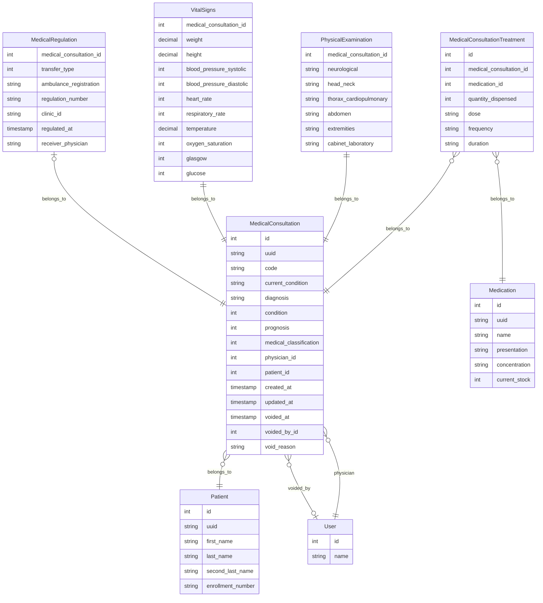

# Consultas médicas

Este documento describe el módulo de consultas médicas implementado en la etapa 04: las cuatro tablas que almacenan una
consulta, sus enums y su código generado, las reglas de validación y autorización, la búsqueda de pacientes basada en
Scout del dashboard del personal y las páginas que componen el flujo de consulta.

En resumen:

- Solo el personal autenticado usa este módulo. Todas las rutas están detrás del middleware `auth` más una comprobación
  `can:`; no existe ninguna superficie de consultas pública ni orientada a pacientes.
- Una consulta es un único agregado: una fila de `medical_consultations` más exactamente una fila de signos vitales,
  exactamente una fila de exploración física y una fila opcional de regulación médica (traslado). El agregado siempre se
  escribe en una sola transacción.
- El usuario autenticado que crea una consulta se convierte en su médico. Solo ese médico (con el permiso
  correspondiente) puede editarla o anularla; `super-admin` omite esta restricción mediante `Gate::before()` (ver
  [ADR-0005](../adr/0005-permission-taxonomy-and-role-catalog.md)). Quien tenga `consultations.void-any` también puede
  anular y restaurar consultas de otros médicos.
- Una consulta **nunca se elimina físicamente**: se anula con un motivo obligatorio y puede restaurarse (ver
  [Anulación y restauración](#anulación-y-restauración)). Cada cambio queda registrado en una bitácora de auditoría
  inmutable (ver [Historial de cambios](#historial-de-cambios) y
  [ADR-0009](../adr/0009-bitacora-de-auditoria-de-consultas-medicas.md)).
- Un paciente **deshabilitado** no recibe consultas nuevas, pero sus consultas existentes siguen visibles y sin cambios
  (ver [Pacientes deshabilitados](#pacientes-deshabilitados)).
- Los pacientes se localizan mediante Laravel Scout + Meilisearch (ver
  [ADR-0006](../adr/0006-busqueda-de-pacientes-con-scout-y-meilisearch.md)).
- El tratamiento de una consulta dispensa medicamentos de un inventario real con libro de movimientos (ver
  [Tratamiento](#tratamiento), [inventario de medicamentos](medication-inventory.md) y
  [ADR-0007](../adr/0007-inventario-de-medicamentos-y-libro-de-movimientos.md)).

Convenciones usadas en todo este documento:

- Los timestamps son `TIMESTAMP WITH TIME ZONE` y la zona horaria de la aplicación es `UTC` (`config/app.php`).
- Todas las columnas enteras con códigos de dominio están respaldadas por un backed enum de PHP (tipo de respaldo
  `int`); la base de datos impone el mismo dominio de valores de forma independiente mediante una restricción `CHECK`
  con nombre.
- Las tres tablas hijas usan `medical_consultation_id` como clave primaria, lo que hace que cada una tenga una relación
  uno a uno con la consulta, y su clave foránea se elimina en cascada.

## MedicalConsultation

Nombre de la tabla: `medical_consultations`

| columna                | tipo                     | restricciones                                             | descripción                                                                                            |
|------------------------|--------------------------|-----------------------------------------------------------|--------------------------------------------------------------------------------------------------------|
| id                     | SERIAL                   | PK                                                        | Clave primaria sustituta de la consulta.                                                               |
| uuid                   | UUID                     | NOT NULL, UNIQUE                                          | Identificador público (UUID v7, generado en el hook `creating` del modelo); se usa como clave de ruta. |
| code                   | VARCHAR(14)              | NOT NULL, UNIQUE, CHECK (code ~ '^MC-[0-9]{6}-[0-9]{4}$') | Código secuencial diario legible (ver [Código de consulta](#código-de-consulta)).                      |
| current_condition      | VARCHAR(1024)            | NOT NULL                                                  | Padecimiento actual / motivo de la visita ("Padecimiento actual").                                     |
| diagnosis              | VARCHAR(1024)            | NOT NULL                                                  | Diagnóstico.                                                                                           |
| condition              | SMALLINT                 | NOT NULL, CHECK (condition BETWEEN 1 AND 5)               | Estado del paciente (enum PHP `MedicalState`).                                                         |
| prognosis              | SMALLINT                 | NOT NULL, CHECK (prognosis BETWEEN 1 AND 5)               | Pronóstico (enum PHP `MedicalState`).                                                                  |
| medical_classification | SMALLINT                 | NOT NULL, CHECK (medical_classification BETWEEN 1 AND 10) | Área clínica (enum PHP `MedicalClassification`).                                                       |
| physician_id           | INTEGER                  | NOT NULL, FK users(id)                                    | Usuario que creó la consulta; nunca cambia.                                                            |
| patient_id             | INTEGER                  | NOT NULL, FK patients(id)                                 | Paciente al que pertenece la consulta; nunca cambia.                                                   |
| created_at             | TIMESTAMP WITH TIME ZONE | NULLABLE                                                  | Fecha y hora de creación de la consulta.                                                               |
| updated_at             | TIMESTAMP WITH TIME ZONE | NULLABLE                                                  | Fecha y hora de la última actualización.                                                               |
| voided_at              | TIMESTAMP WITH TIME ZONE | NULLABLE                                                  | Momento de la anulación vigente; `NULL` mientras la consulta está activa (ver [Anulación](#anulación-y-restauración)). |
| voided_by_id           | INTEGER                  | NULLABLE, FK users(id) ON DELETE RESTRICT                 | Usuario que anuló la consulta; `NULL` mientras está activa.                                            |
| void_reason            | VARCHAR(500)             | NULLABLE                                                  | Motivo de la anulación vigente; `NULL` mientras está activa.                                           |

- Las tres columnas de anulación se escriben siempre juntas: `chk_void_state_all_or_none` exige que las tres sean
  `NULL` o que las tres tengan valor. Restaurar una consulta las vuelve a poner en `NULL`; el motivo y el autor de cada
  anulación y restauración permanecen en el [historial de cambios](#historial-de-cambios).
- El índice compuesto sobre (physician_id, created_at) respalda la lista "mis últimas consultas" del dashboard.
- El índice compuesto sobre (patient_id, created_at) respalda la lista "últimas consultas" del resumen del paciente.
- Las claves foráneas `physician_id` y `patient_id` **no** se eliminan en cascada: un usuario o un paciente con
  consultas no puede eliminarse a nivel de base de datos.
- El tratamiento prescrito ya no vive en esta tabla como texto libre: cada línea es una fila relacional de
  `medical_consultation_treatments` (ver [Tratamiento](#tratamiento) más abajo).

## Tratamiento

El tratamiento de una consulta es una lista de líneas relacionales, cada una respaldada por una fila de
`medical_consultation_treatments` que referencia un medicamento del catálogo de inventario y descuenta su
existencia. El módulo completo de inventario (tablas, libro de movimientos, búsqueda y proyección de demanda) se
documenta en [inventario de medicamentos](medication-inventory.md) y
[ADR-0007](../adr/0007-inventario-de-medicamentos-y-libro-de-movimientos.md).

- El payload sigue enviando `treatment` como un arreglo en el nivel superior del request (ver
  [Validación](#validación)), pero cada elemento ahora tiene la forma
  `{ "medication_uuid": "...", "quantity_dispensed": 2, "dose": "500 mg", "frequency": "Every 8 hours", "duration": "5 days" }`
  en lugar de un nombre de medicamento en texto libre.
- `App\Services\Inventory\TreatmentDispensation::sync()` reconcilia las líneas enviadas contra las existentes,
  dentro de la misma transacción del agregado:
  - **Crear** una consulta dispensa la cantidad de cada línea (movimiento `Dispensation`).
  - **Editar** una consulta calcula la diferencia por medicamento entre lo enviado y lo existente: una cantidad
    mayor dispensa la diferencia; una cantidad menor, o quitar la línea por completo, restituye la diferencia como
    un movimiento `DispensationReversal`.
  - **Anular** una consulta restituye el stock de todas sus líneas (`TreatmentDispensation::reverseAll()`, un
    movimiento `DispensationReversal` por línea) **sin borrar las líneas**, que se conservan para poder restaurar.
  - **Restaurar** una consulta vuelve a surtir todas sus líneas (`TreatmentDispensation::redispenseAll()`, un
    movimiento `Dispensation` por línea). Ver [Anulación y restauración](#anulación-y-restauración).
- Si una línea dispensaría más de lo disponible, el servicio lanza `InsufficientStockException`, que la petición
  traduce en un error 422 por línea (ver [Validación](#validación)).

## PhysicalExamination

Nombre de la tabla: `physical_examinations`

| columna                 | tipo         | restricciones                                      | descripción                                   |
|-------------------------|--------------|----------------------------------------------------|-----------------------------------------------|
| medical_consultation_id | INTEGER      | PK, FK medical_consultations(id) ON DELETE CASCADE | Consulta a la que pertenece esta exploración. |
| neurological            | VARCHAR(512) | NOT NULL                                           | Hallazgos neurológicos.                       |
| head_neck               | VARCHAR(512) | NOT NULL                                           | Hallazgos de cabeza y cuello.                 |
| thorax_cardiopulmonary  | VARCHAR(512) | NOT NULL                                           | Hallazgos de tórax y cardiopulmonares.        |
| abdomen                 | VARCHAR(512) | NOT NULL                                           | Hallazgos abdominales.                        |
| extremities             | VARCHAR(512) | NOT NULL                                           | Hallazgos en extremidades.                    |
| cabinet_laboratory      | VARCHAR(512) | NOT NULL                                           | Resultados de gabinete y laboratorio.         |

## VitalSigns

Nombre de la tabla: `vital_signs`

| columna                  | tipo         | restricciones                                         | descripción                                         |
|--------------------------|--------------|-------------------------------------------------------|-----------------------------------------------------|
| medical_consultation_id  | INTEGER      | PK, FK medical_consultations(id) ON DELETE CASCADE    | Consulta a la que pertenecen estos signos vitales.  |
| weight                   | DECIMAL(5,2) | NOT NULL                                              | Peso en kilogramos (kg).                            |
| height                   | DECIMAL(3,2) | NOT NULL                                              | Estatura en **metros** (m), por ejemplo `1.72`.     |
| blood_pressure_systolic  | SMALLINT     | NOT NULL                                              | Presión arterial sistólica (mmHg).                  |
| blood_pressure_diastolic | SMALLINT     | NOT NULL                                              | Presión arterial diastólica (mmHg).                 |
| heart_rate               | SMALLINT     | NOT NULL                                              | Frecuencia cardiaca (latidos por minuto).           |
| respiratory_rate         | SMALLINT     | NOT NULL                                              | Frecuencia respiratoria (respiraciones por minuto). |
| temperature              | DECIMAL(3,1) | NOT NULL                                              | Temperatura corporal (°C).                          |
| oxygen_saturation        | SMALLINT     | NOT NULL, CHECK (oxygen_saturation BETWEEN 0 AND 100) | Saturación de oxígeno, SpO2 (%).                    |
| glasgow                  | SMALLINT     | NOT NULL, CHECK (glasgow BETWEEN 3 AND 15)            | Puntuación en la escala de coma de Glasgow.         |
| glucose                  | SMALLINT     | NULLABLE                                              | Glucosa capilar (mg/dL); opcional.                  |

- El modelo `VitalSigns` convierte `weight` y `height` a `decimal:2` y `temperature` a `decimal:1`, por lo que llegan al
  frontend como cadenas con precisión fija.

## MedicalRegulation

Nombre de la tabla: `medical_regulations`

Una regulación registra que el paciente fue trasladado ("regulado") a otra unidad. Es opcional: la mayoría de las
consultas no tiene una fila aquí.

| columna                 | tipo                     | restricciones                                      | descripción                                                     |
|-------------------------|--------------------------|----------------------------------------------------|-----------------------------------------------------------------|
| medical_consultation_id | INTEGER                  | PK, FK medical_consultations(id) ON DELETE CASCADE | Consulta a la que pertenece esta regulación.                    |
| transfer_type           | SMALLINT                 | NOT NULL, CHECK (transfer_type BETWEEN 1 AND 3)    | Forma en que se traslada al paciente (enum PHP `TransferType`). |
| ambulance_registration  | VARCHAR(255)             | NULLABLE                                           | Número de registro de la ambulancia.                            |
| regulation_number       | VARCHAR(255)             | NULLABLE                                           | Número de regulación (referencia).                              |
| clinic_id               | VARCHAR(255)             | NULLABLE                                           | Identificador de la clínica receptora.                          |
| regulated_at            | TIMESTAMP WITH TIME ZONE | NOT NULL                                           | Fecha y hora de la regulación.                                  |
| receiver_physician      | VARCHAR(255)             | NULLABLE                                           | Nombre del médico receptor.                                     |

## Enums

El backend solo envía valores enteros crudos; las etiquetas en español de la UI viven en
`resources/js/lib/consultationLabels.ts`.

- Enum PHP `MedicalState`, usado tanto por `condition` como por `prognosis`:
    - 1: Good — "Bueno"
    - 2: Fair — "Regular"
    - 3: Serious — "Grave"
    - 4: Critical — "Crítico"
    - 5: Guarded — "Reservado"

- Enum PHP `MedicalClassification`, valores de `medical_classification`:
    - 1: Trauma — "Traumatología"
    - 2: Otolaryngology — "Otorrinolaringología"
    - 3: Respiratory — "Respiratorio"
    - 4: Gastroenterology — "Gastroenterología"
    - 5: Ophthalmology — "Oftalmología"
    - 6: Cardiology — "Cardiología"
    - 7: Dermatology — "Dermatología"
    - 8: Neurology — "Neurología"
    - 9: Endocrinology — "Endocrinología"
    - 10: Psychiatry — "Psiquiatría"

- Enum PHP `TransferType`, valores de `transfer_type`:
    - 1: Institute — "Instituto"
    - 2: MunicipalHealthServices — "Servicios de Salud Municipales"
    - 3: OwnResources — "Medios propios"

## Restricciones únicas e índices con nombre

| Tabla                 | Nombre de la restricción                              | Columnas                              |
|-----------------------|-------------------------------------------------------|---------------------------------------|
| medical_consultations | medical_consultations_uuid_unique                     | UNIQUE (uuid)                         |
| medical_consultations | medical_consultations_code_unique                     | UNIQUE (code)                         |
| medical_consultations | medical_consultations_physician_id_created_at_index   | INDEX (physician_id, created_at)      |
| medical_consultations | medical_consultations_patient_id_created_at_index     | INDEX (patient_id, created_at)        |
| medical_consultations | medical_consultations_voided_at_index                 | INDEX (voided_at)                     |
| medical_consultations | medical_consultations_physician_id_foreign            | FK (physician_id) → users(id)         |
| medical_consultations | medical_consultations_patient_id_foreign              | FK (patient_id) → patients(id)        |
| medical_consultations | medical_consultations_voided_by_id_foreign            | FK (voided_by_id) → users(id), RESTRICT |
| physical_examinations | physical_examinations_medical_consultation_id_foreign | FK (medical_consultation_id), CASCADE |
| vital_signs           | vital_signs_medical_consultation_id_foreign           | FK (medical_consultation_id), CASCADE |
| medical_regulations   | medical_regulations_medical_consultation_id_foreign   | FK (medical_consultation_id), CASCADE |

## Restricciones CHECK con nombre

| Tabla                 | Nombre de la restricción          | Regla                                     |
|-----------------------|-----------------------------------|-------------------------------------------|
| medical_consultations | chk_code_format                   | `code ~ '^MC-[0-9]{6}-[0-9]{4}$'`         |
| medical_consultations | chk_condition_domain              | `condition BETWEEN 1 AND 5`               |
| medical_consultations | chk_prognosis_domain              | `prognosis BETWEEN 1 AND 5`               |
| medical_consultations | chk_medical_classification_domain | `medical_classification BETWEEN 1 AND 10` |
| medical_consultations | chk_void_state_all_or_none        | `voided_at`, `voided_by_id` y `void_reason` son los tres `NULL` o los tres con valor |
| vital_signs           | chk_glasgow_domain                | `glasgow BETWEEN 3 AND 15`                |
| vital_signs           | chk_oxygen_saturation_domain      | `oxygen_saturation BETWEEN 0 AND 100`     |
| medical_regulations   | chk_transfer_type_domain          | `transfer_type BETWEEN 1 AND 3`           |

## Código de consulta

Cada consulta recibe un código como `MC-260923-0007`, generado por `App\Support\MedicalConsultationCode::next()` desde
el hook `creating` del modelo. Los clientes nunca lo envían y nunca cambia.

| Aspecto      | Regla                                                                                                                                                                                                                                                           |
|--------------|-----------------------------------------------------------------------------------------------------------------------------------------------------------------------------------------------------------------------------------------------------------------|
| Formato      | `MC-YYMMDD-NNNN`, siempre de 14 caracteres; lo impone `chk_code_format` y `code` es `UNIQUE`.                                                                                                                                                                   |
| Secuencia    | `NNNN` se reinicia en `0001` cada día y se incrementa de uno en uno (siguiente = código más alto existente del día + 1).                                                                                                                                        |
| Día          | `YYMMDD` es el día calendario actual en `America/Mexico_City`, mientras que `created_at` se almacena en UTC. Por lo tanto, una consulta creada a las 23:30 hora local lleva ese día local en su código aunque su timestamp UTC ya corresponda al día siguiente. |
| Concurrencia | Toma `pg_advisory_xact_lock(hashtext('medical_consultations.code'), YYMMDD)`, de modo que las creaciones concurrentes del mismo día se serializan en lugar de competir por el mismo número. El lock se libera al hacer commit o rollback.                       |
| Transacción  | Debe ejecutarse dentro de una transacción abierta; fuera de una lanza una `LogicException`. `MedicalConsultationController::store()` envuelve todo el agregado en `DB::transaction()`.                                                                          |
| Límite       | 9999 consultas por día; la número 10,000 lanza una `RuntimeException`.                                                                                                                                                                                          |

## Validación

`StoreMedicalConsultationRequest` y `UpdateMedicalConsultationRequest` validan el mismo agregado. Puntos destacados:

| Regla                          | Detalle                                                                                                                                                                                                   |
|--------------------------------|-----------------------------------------------------------------------------------------------------------------------------------------------------------------------------------------------------------|
| Claves desconocidas rechazadas | Ambos requests llevan `#[FailOnUnknownFields]`; cualquier clave no declarada en `rules()` (en cualquier nivel de anidamiento) hace fallar la validación.                                                  |
| El paciente es inmutable       | Solo el request de creación acepta `patient_uuid` (debe existir en `patients.uuid`). En la actualización es una clave desconocida y se rechaza; `code` y `physician_id` tampoco se aceptan nunca.         |
| Precisión decimal              | `weight` y `height` usan `decimal:0,2`; `temperature` usa `decimal:0,1`, en concordancia con la escala de la columna.                                                                                     |
| Rangos fisiológicos            | peso 0.5–500, estatura 0.30–2.50, sistólica 40–300, diastólica 20–200, frecuencia cardiaca 20–300, frecuencia respiratoria 4–80, temperatura 30–45, SpO2 0–100, Glasgow 3–15, glucosa 10–2000 (nullable). |
| Diastólica < sistólica         | Un callback `after()` rechaza `diastolic >= systolic` en `vital_signs.blood_pressure_diastolic` (solo cuando ambos campos pasaron sus propias reglas).                                                    |
| Tratamiento                    | `treatment` es `present`, array, `max:20` líneas. Cada `medication_uuid` es obligatorio, `uuid`, `distinct` entre líneas y debe referenciar un medicamento activo; al editar, también acepta un medicamento inactivo si ya está vinculado a esa consulta. `quantity_dispensed` es entero entre 1 y 9999. `dose`, `frequency` y `duration` siguen siendo texto libre obligatorio (máx. 255 caracteres). Un error de existencia insuficiente se devuelve como un 422 por línea, con clave `treatment.N.quantity_dispensed` (`N` es el índice base cero de la línea). Ver [Tratamiento](#tratamiento). |
| Regulación                     | `regulation` es nullable; cuando está presente, `transfer_type` y `regulated_at` son `required_with:regulation` y el resto son opcionales.                                                                |

El payload anida `current_condition` y `diagnosis` bajo `consultation`, y las entidades hijas bajo `vital_signs`,
`physical_examination` y `regulation`; `condition`, `prognosis`, `medical_classification` y `treatment` están en el
nivel superior. Los mensajes de error y los nombres de atributos provienen de
`lang/es/modules/consultations/management.php`.

En la actualización, enviar `regulation: null` elimina una fila de regulación existente; enviar un objeto la crea o la
reemplaza.

## Autorización

El módulo usa ocho permisos de `App\Enums\Permission`:

| Permiso                     | Otorga                                                                                                     |
|-----------------------------|------------------------------------------------------------------------------------------------------------|
| `consultations.view`        | Dashboard, detalle de la consulta, endpoint de últimas consultas.                                          |
| `consultations.create`      | Página de nueva consulta y guardado de una consulta nueva.                                                 |
| `consultations.update`      | Edición de una consulta — **solo las propias**.                                                            |
| `consultations.void`        | Anular y restaurar una consulta — **solo las propias** (sustituye al antiguo `consultations.delete`).      |
| `consultations.void-any`    | Anular y restaurar la consulta de **cualquier** médico; también permite ver las anuladas.                  |
| `consultations.view-voided` | Ver las consultas anuladas de cualquier médico (detalle y resumen del paciente), sin poder anular.         |
| `consultations.audit`       | Leer el historial de cambios de una consulta (no exige ser su médico).                                     |
| `patients.view`             | Búsqueda de pacientes, (junto con `consultations.view`) el resumen del paciente y los datos sensibles del perfil. |

Reglas de `MedicalConsultationPolicy`:

| Habilidad  | Regla                                                                                                                                              |
|------------|----------------------------------------------------------------------------------------------------------------------------------------------------|
| `view`     | Requiere `consultations.view`. Si la consulta está anulada, además: ser su médico, o tener `consultations.view-voided` o `consultations.void-any`. |
| `update`   | Consulta **no anulada**, `consultations.update` **y** propiedad (`$consultation->physician_id === $user->id`).                                      |
| `void`     | Consulta **no anulada**, y `consultations.void-any` o (`consultations.void` y propiedad).                                                           |
| `restore`  | Consulta **anulada**, y la misma regla que `void`.                                                                                                  |
| `audit`    | Solo `consultations.audit`; no depende de la propiedad ni del estado.                                                                               |

- Tener solo `consultations.update` no permite a un usuario editar la consulta de un colega; lo mismo aplica a
  `consultations.void` sin `consultations.void-any`.
- `super-admin` nunca se trata como caso especial en una Policy. Su acceso irrestricto (incluidas las consultas de otros
  médicos) proviene únicamente del callback `Gate::before()` en `AppServiceProvider` (ver
  [ADR-0005](../adr/0005-permission-taxonomy-and-role-catalog.md)
  y [usuarios, roles y permisos](users-roles-permissions.md)). Como esa omisión salta la Policy, el servicio
  `ConsultationVoiding` vuelve a comprobar el estado dentro de la transacción y rechaza una anulación o restauración
  inválida (HTTP 422) también para `super-admin`.
- Una consulta anulada no puede editarse ni anularse de nuevo: sus rutas de edición, actualización y anulación
  responden 404 para todos, porque la ruta no resuelve consultas anuladas. Solo las rutas de detalle, restauración e
  historial las resuelven.
- Tanto los controladores como las páginas exponen los flags `can.update` / `can.void` / `can.restore` / `can.audit`
  para que la UI oculte Editar, Anular, Restaurar e Historial de cambios; el middleware `can:` del servidor sigue
  siendo el límite real (HTTP 403 en caso contrario).
- La barra lateral muestra la entrada "Consultas" solo a los usuarios con `consultations.view`.

> **Datos sensibles del perfil.** La tarjeta plegable del perfil del paciente en las páginas de creación, detalle y
> edición se arma con `App\Support\Patients\PatientProfile`. Quien abre esas páginas (`consultations.create` o
> `consultations.view`) ve la identidad y los datos clínicos, pero el número de seguridad social, los correos y todos
> los teléfonos (incluidos los de los contactos de emergencia) solo se envían a quien tiene `patients.view`; para los
> demás llegan como `null` y la interfaz los omite. La misma regla aplica al resumen del paciente del dashboard.
> `super-admin` los recibe por el bypass de `Gate::before()`. Ver
> [gestión de pacientes](patient-management.md#exposición-de-datos-sensibles).

## Pacientes deshabilitados

Deshabilitar un paciente (ver [gestión de pacientes](patient-management.md#deshabilitar-y-habilitar)) no toca sus
consultas: ninguna fila de consulta, signos vitales, exploración, regulación ni tratamiento cambia, y el inventario no
se mueve.

| Tema | Comportamiento |
|------|----------------|
| Consultas existentes | Siguen visibles, en el detalle de la consulta y en el del paciente, con las reglas de visibilidad de siempre (incluidas las anuladas). |
| Editar o anular una consulta existente | Sigue permitido con las reglas de siempre; la consulta conserva su paciente. |
| Página de nueva consulta | `GET /consultations/create?patient={uuid}` responde **403** para cualquier usuario, incluido `super-admin`. |
| Guardar una consulta nueva | `POST /consultations` falla con un error de validación (422) en `patient_uuid`: "El paciente está deshabilitado y no admite nuevas consultas." |
| Carrera con una deshabilitación | `ConsultationWriter::create` vuelve a leer al paciente con bloqueo compartido; la deshabilitación toma bloqueo exclusivo, de modo que nunca se crea una consulta sobre un paciente recién deshabilitado. |
| Búsqueda del dashboard | Los pacientes deshabilitados aparecen marcados ("Deshabilitado") y **no se pueden seleccionar** en el buscador de nueva consulta. |
| Resumen del paciente | Expone `is_disabled` y `can.createConsultation`; con el paciente deshabilitado no se ofrece "Nueva consulta". |
| Enlaces al paciente | El nombre del paciente en las páginas de consulta y en el resumen enlaza a `patients/{uuid}` solo si el usuario tiene `patients.view`. |

## Anulación y restauración

Una consulta no se elimina: se **anula**. Anular conserva la consulta, sus signos vitales, su exploración, su regulación
y todas sus líneas de tratamiento; solo marca `voided_at`, `voided_by_id` y `void_reason`. Los modelos usan
`SoftDeletes` con `voided_at` como columna de borrado lógico, de modo que las consultas anuladas quedan fuera de las
consultas normales.

`App\Services\MedicalConsultations\ConsultationVoiding` ejecuta ambas operaciones en una única transacción: bloquea la
fila de la consulta (`lockForUpdate`), vuelve a comprobar su estado y mueve el stock una sola vez. De dos peticiones
concurrentes, exactamente una surte efecto; la otra recibe un 422.

| Operación | Motivo                                       | Efecto sobre el stock                                                                                                                | Resultado                                                                     |
|-----------|----------------------------------------------|---------------------------------------------------------------------------------------------------------------------------------------|-------------------------------------------------------------------------------|
| Anular    | `reason` obligatorio, cadena de máx. 500     | Devuelve al inventario el stock de **todas** las líneas (un movimiento `DispensationReversal` por línea); las líneas no se borran.      | Rellena las tres columnas de anulación y registra un evento `voided`.         |
| Restaurar | `reason` obligatorio, cadena de máx. 500     | Vuelve a surtir **todas** las líneas (un movimiento `Dispensation` por línea). Admite medicamentos inactivos, pero no existencia insuficiente. | Vacía las tres columnas de anulación y registra un evento `restored`.        |

- Anular **siempre** devuelve el stock y restaurar **siempre** vuelve a surtirlo; no existe una opción para omitirlo.
- Si al restaurar alguna línea excede la existencia actual de su medicamento, **no se escribe nada** (ni stock ni estado):
  la petición responde 422 con un error por línea, con clave `treatment.N` (`N` es la posición base cero de la línea,
  ordenada por id) y el mensaje "No se puede restaurar: existencia insuficiente de :medication. Disponible: :available.".
  La consulta sigue anulada.
- Anular una consulta ya anulada, o restaurar una que no lo está, responde 422 con un error en la clave `consultation`
  ("La consulta ya fue anulada." / "La consulta no está anulada."). Es la última barrera, que cubre la concurrencia y a
  `super-admin`; en el flujo normal la ruta rechaza antes la petición (404 al anular una consulta ya anulada, 403 al
  restaurar una que no lo está; ver [Autorización](#autorización)).
- Una consulta puede anularse y restaurarse varias veces; cada ciclo queda en el historial con su motivo y autor.
- El código de la consulta (`MC-YYMMDD-NNNN`) no se reutiliza: la fila sigue existiendo, así que la siguiente consulta
  del día continúa la secuencia.

### Visibilidad de las consultas anuladas

- **Dashboard**: "Mis últimas consultas" oculta las anuladas por defecto. El interruptor "Incluir anuladas" (parámetro
  `include_voided`) las muestra, con la insignia "Anulada", entre las 10 últimas consultas propias del usuario.
- **Resumen del paciente**: lista hasta 5 consultas recientes e incluye las anuladas que el usuario puede ver, con la
  insignia "Anulada". Quien no tiene `consultations.view-voided` ni `consultations.void-any` solo ve las anuladas que
  son propias.
- **Detalle** (`consultations/Show`): una consulta anulada solo se abre para su médico y para quienes tienen
  `consultations.view-voided` o `consultations.void-any`; el resto recibe 403. La página muestra el aviso "Anulada" con
  la fecha, quién la anuló y el motivo, oculta el botón Editar y ofrece "Restaurar consulta" en lugar de "Anular
  consulta" cuando `can.restore` es verdadero.

## Historial de cambios

Cada creación, edición, anulación y restauración queda registrada en la tabla `audits` (paquete
`owen-it/laravel-auditing`, ver [ADR-0009](../adr/0009-bitacora-de-auditoria-de-consultas-medicas.md)). La bitácora es
**inmutable**: `App\Models\Audit` lanza una `LogicException` ante cualquier actualización o eliminación y nunca se
purga.

- Se auditan la consulta y sus cuatro entidades dependientes (`VitalSigns`, `PhysicalExamination`, `MedicalRegulation` y
  las líneas de `MedicalConsultationTreatment`). Todas llevan la etiqueta `consultation:{id}`.
- Un guardado del formulario modifica varias tablas pero se muestra como **un solo cambio**: todas las filas de
  auditoría de una operación comparten el mismo `batch_id`, y el historial agrupa por ese lote.
- Anular y restaurar registran un único evento personalizado (`voided` / `restored`) con el motivo; los movimientos de
  stock que provocan se consultan en el libro de movimientos del inventario, no en el historial.
- Cada grupo indica **quién** (nombre del usuario), **cuándo** y **qué**: el tipo de evento (Creación, Modificación,
  Anulación o Restauración), el motivo cuando aplica y, para las modificaciones, una tabla Campo / Anterior / Nuevo
  por sección (consulta, signos vitales, exploración física, regulación, tratamiento). Los valores de enums se muestran
  con su etiqueta en español y las líneas de tratamiento con el nombre, presentación y concentración del medicamento.

`GET /consultations/{consultation}/history` (permiso `consultations.audit`) devuelve JSON con `data` (grupos, del más
reciente al más antiguo, 20 por página) y `next_cursor` (`null` al final); el cursor se envía como `?cursor=`. En la
interfaz, el botón "Historial de cambios" de la página de detalle abre un diálogo con estados de carga, vacío ("Esta
consulta no tiene cambios registrados.") y error, y un botón "Cargar más".

## Indexación para la búsqueda de pacientes

La búsqueda de pacientes sigue [ADR-0006](../adr/0006-busqueda-de-pacientes-con-scout-y-meilisearch.md):

| Tema                  | Comportamiento                                                                                                                                                                           |
|-----------------------|------------------------------------------------------------------------------------------------------------------------------------------------------------------------------------------|
| Motor                 | Laravel Scout con Meilisearch; el servicio `meilisearch` de `docker-compose.dev.yml` está fijado a `getmeili/meilisearch:v1.54.0`.                                                       |
| Campos indexados      | `Patient::toSearchableArray()` envía `first_name`, `last_name`, `second_last_name`, `enrollment_number` e `is_disabled`; `config/scout.php` declara los cuatro primeros como `searchableAttributes` e `is_disabled` como atributo filtrable. |
| Cuándo se indexa      | `after_commit` es `true`, por lo que un registro de paciente revertido (rollback) nunca se indexa.                                                                                       |
| Cómo se indexa        | De forma síncrona (`queue` es `false`); no hay worker de colas.                                                                                                                          |
| Pruebas               | `phpunit.xml` establece `SCOUT_DRIVER=collection`, por lo que la suite no necesita Meilisearch.                                                                                          |
| Configuración inicial | `make setup` ejecuta `php artisan scout:sync-index-settings` y `php artisan scout:import "App\Models\Patient"` después de migrar.                                                        |
| Consulta              | `GET /dashboard/patients/search?query=…` (1–100 caracteres) devuelve como máximo 10 coincidencias.                                                                                       |
| Cliente               | `PatientSearch.vue` busca desde 1 carácter con un debounce de 50 ms y aborta las peticiones en curso.                                                                                    |

**Si Meilisearch no está disponible:** como la indexación es síncrona y posterior al commit, el registro público de
pacientes (`POST /patients/register`) guarda al paciente en Postgres pero luego falla con un error no controlado, de
modo que el usuario ve un error aunque el registro exista. Las peticiones de búsqueda del dashboard también fallan y el
cuadro de búsqueda no muestra resultados. Esta es la consecuencia documentada y aceptada en ADR-0006.

> `config/scout.php` recurre al driver `collection` cuando `SCOUT_DRIVER` no está definido, por lo que un entorno debe
> establecer `SCOUT_DRIVER=meilisearch` de forma explícita para usar Meilisearch.

## Rutas y páginas

Todas las rutas requieren `auth`; la autorización la aplica el middleware `can:` de cada ruta.

| Método | URI                                    | Nombre                           | Autorización                           | Respuesta                                                                                       |
|--------|----------------------------------------|----------------------------------|----------------------------------------|-------------------------------------------------------------------------------------------------|
| GET    | `/dashboard`                           | `dashboard.index`                | `consultations.view`                   | Inertia `dashboard/Index`                                                                       |
| GET    | `/dashboard/patients/search`           | `dashboard.patients.search`      | `patients.view`                        | JSON, hasta 10 pacientes (incluye deshabilitados con `is_disabled`)                             |
| GET    | `/dashboard/patients/{patient}`        | `dashboard.patients.summary`     | `patients.view` + `consultations.view` | JSON, datos básicos del paciente (sin datos sensibles si falta `patients.view`) + 5 últimas consultas |
| GET    | `/dashboard/consultations`             | `dashboard.consultations.latest` | `consultations.view`                   | JSON, las 10 últimas consultas propias                                                          |
| GET    | `/consultations/create?patient={uuid}` | `consultations.create`           | `consultations.create`                 | Inertia `consultations/Create` (422 ante un UUID mal formado, 404 ante un paciente desconocido, 403 ante un paciente deshabilitado) |
| POST   | `/consultations`                       | `consultations.store`            | `consultations.create`                 | Redirect a `dashboard.index` con flash                                                          |
| GET    | `/consultations/{consultation}`        | `consultations.show`             | `view` (ver [Autorización](#autorización)) | Inertia `consultations/Show` (también resuelve consultas anuladas)                          |
| GET    | `/consultations/{consultation}/edit`   | `consultations.edit`             | `consultations.update` + propiedad     | Inertia `consultations/Edit`                                                                    |
| PUT    | `/consultations/{consultation}`        | `consultations.update`           | `consultations.update` + propiedad     | Redirect a `dashboard.index` con flash                                                          |
| POST   | `/consultations/{consultation}/void`   | `consultations.void`             | `void` (ver [Autorización](#autorización)) | Redirect a `consultations.show` con flash                                                   |
| POST   | `/consultations/{consultation}/restore` | `consultations.restore`         | `restore` (ver [Autorización](#autorización)) | Redirect a `consultations.show` con flash                                                |
| GET    | `/consultations/{consultation}/history` | `consultations.history`         | `consultations.audit`                  | JSON, una página de grupos de cambios (parámetro opcional `cursor`)                             |

`{patient}` y `{consultation}` se resuelven por `uuid`, nunca por el id numérico. **No existe ninguna ruta de
eliminación**: no hay `DELETE /consultations/{consultation}` y la consulta y sus filas hijas nunca se borran. Las rutas
de anulación y restauración requieren el campo `reason` (ver [Anulación y restauración](#anulación-y-restauración)).

### Flujo de la interfaz

1. **Dashboard** (`dashboard/Index.vue`): la barra de búsqueda de pacientes (visible solo con `patients.view`) y la
   tabla "Mis últimas consultas" con las 10 últimas consultas propias del usuario. Las anuladas se ocultan salvo que se
   active "Incluir anuladas".
2. **Búsqueda → resumen**: al seleccionar un resultado se abre `PatientSummaryDialog`, que obtiene el resumen del
   paciente y lista hasta 5 consultas recientes (cada una enlaza a su página de detalle). Si el usuario tiene
   `patients.view`, el nombre enlaza al detalle del paciente; un paciente deshabilitado muestra la insignia
   "Deshabilitado" y sin botón de nueva consulta.
3. **Nueva consulta**: el botón "Nueva consulta" del diálogo (visible solo con `consultations.create`) abre
   `consultations/Create` para ese paciente.
4. **Tratamiento** (`TreatmentRows`): cada línea tiene un selector de medicamento (combobox de medicamentos activos,
   más el ya vinculado si se está editando) que muestra la existencia disponible como texto puramente informativo
   (por ejemplo, "Paracetamol · Tableta 500 mg · 120 disponibles"), y un campo de cantidad dispensada. El formulario
   **no** valida la existencia en el navegador: un intento de dispensar más de lo disponible solo se rechaza en la
   respuesta del servidor (ver [Tratamiento](#tratamiento)).
5. **Guardar**: `ConsultationForm` envía el agregado; si tiene éxito, el usuario regresa al dashboard con un toast de
   Sonner como "Consulta MC-260923-0007 registrada" (o "actualizada" tras editar).
6. **Detalle** (`consultations/Show`): detalle de solo lectura. Los botones dependen de los flags `can`: Editar
   (`can.update`), "Anular consulta" (`can.void`), "Restaurar consulta" (`can.restore`) e "Historial de cambios"
   (`can.audit`). Una consulta anulada muestra el aviso "Anulada" (fecha, autor y motivo).
7. **Anular / restaurar**: cada acción abre un `AlertDialog` que exige el motivo (obligatorio, máx. 500 caracteres) y
   explica el efecto sobre el inventario. Tras confirmar, el usuario regresa a la página de detalle con un toast como
   "Consulta MC-260923-0007 anulada" (o "restaurada"). Si la
   restauración se rechaza por existencia insuficiente, el diálogo muestra el error de cada línea y la consulta sigue
   anulada.
8. **Edición** (`consultations/Edit`): el mismo formulario, precargado. La edición ya no ofrece eliminar la consulta.

En las páginas de creación, detalle y edición, `PatientProfileCard` se ubica encima del formulario o del detalle (omite los campos sensibles que el servidor no envió). Inicia
plegada ("Mostrar" / "Ocultar") y agrupa el perfil en pestañas: "Datos generales", "Contacto", "Contactos de
emergencia", "Padecimientos", "Otros padecimientos" y — para pacientes de sexo femenino o cuando existe un registro —
"Historial ginecológico".

## Datos de desarrollo

```bash
php artisan db:seed --class=PatientSeeder
```

- Crea 50 pacientes con perfiles completos mediante `PatientFactory::withCompleteProfile()` (información de contacto,
  1–2 contactos de emergencia, 0–3 padecimientos, otros padecimientos en ~40% de los casos e historial ginecológico para
  pacientes de sexo femenino).
- Solo se ejecuta en el entorno `local`; en cualquier otro no hace nada.
- **No** lo invoca `DatabaseSeeder`, y espera que los seeders de catálogos (`LocationSeeder`,
  `FamilyMedicalUnitSeeder`, `EnrollmentSeeder`) se hayan ejecutado antes.
- Solo siembra pacientes, no consultas. Ejecuta `php artisan scout:import "App\Models\Patient"` después si los pacientes
  todavía no aparecen en la búsqueda.

`make seed-demo` (`php artisan demo:seed`, ver [inventario de medicamentos](medication-inventory.md#datos-de-desarrollo))
también siembra consultas con historial de auditoría: `DemoConsultationHistorySeeder` aplica, mediante los servicios
reales y con un usuario autor, ediciones, una línea de tratamiento agregada y otra quitada, anulaciones por el médico
demo y por Coordinación médica, y una anulación seguida de restauración, siempre con motivos en español. Los usuarios
demo incluyen `coordinacion@vitalease.test` (ver [usuarios, roles y permisos](users-roles-permissions.md)). El
sembrador de pacientes demo también deja pacientes editados y deshabilitados (ver
[gestión de pacientes](patient-management.md#datos-de-demostración)).

## Fuera de alcance

- **La eliminación física de consultas** no existe: una consulta solo se anula, y el paciente y el médico de una
  consulta nunca cambian.
- **Las firmas y un flujo de revisor/revisión** se eliminaron de esta etapa: una consulta no tiene firma, ni revisor, ni
  estado de revisión.
- **Los reportes y exportaciones** (PDF, Excel) de consultas corresponden a una etapa posterior; nada en este módulo
  las genera. `reports.generate` ya no está sin usar: gatea el reporte de proyección de demanda de medicamentos
  (`reports.medication-demand`), documentado en [inventario de medicamentos](medication-inventory.md).

## Diagrama entidad-relación


